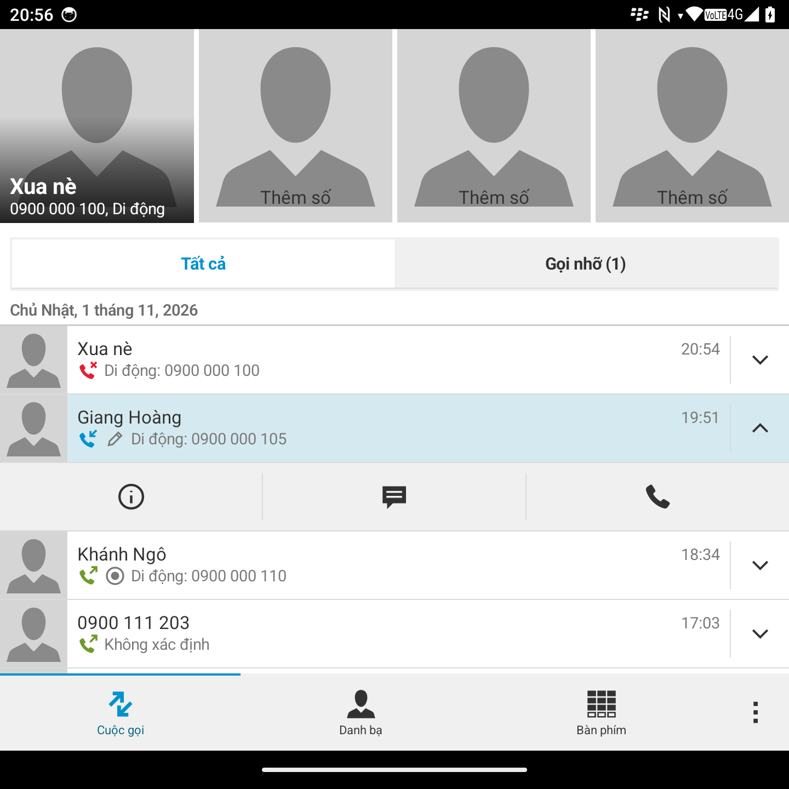
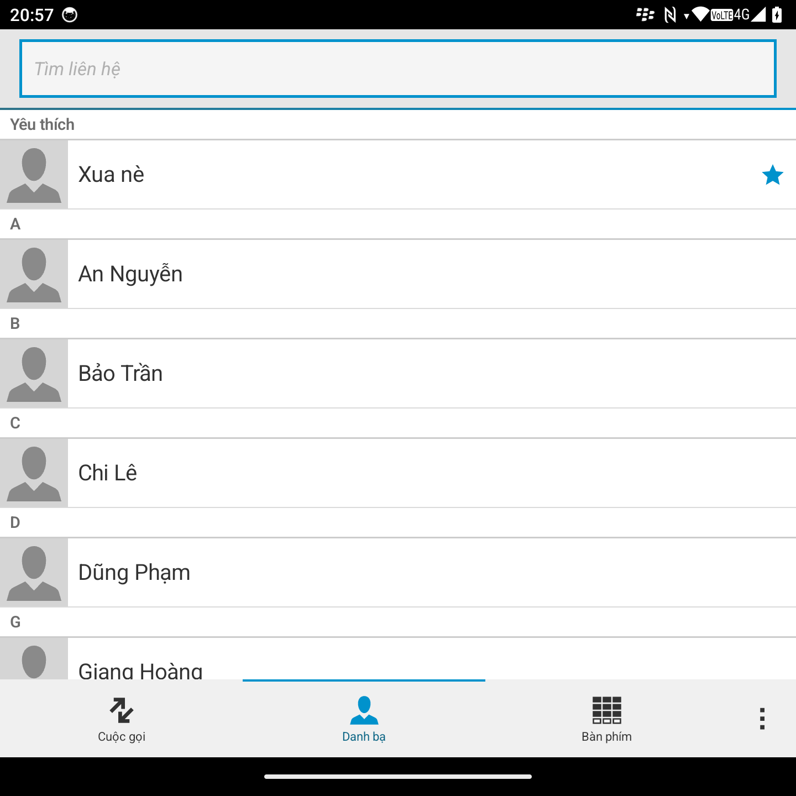
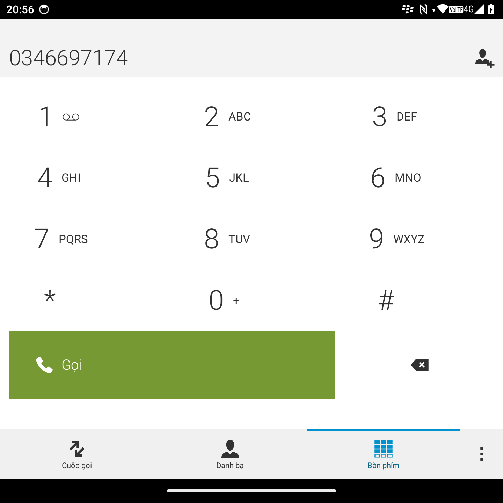
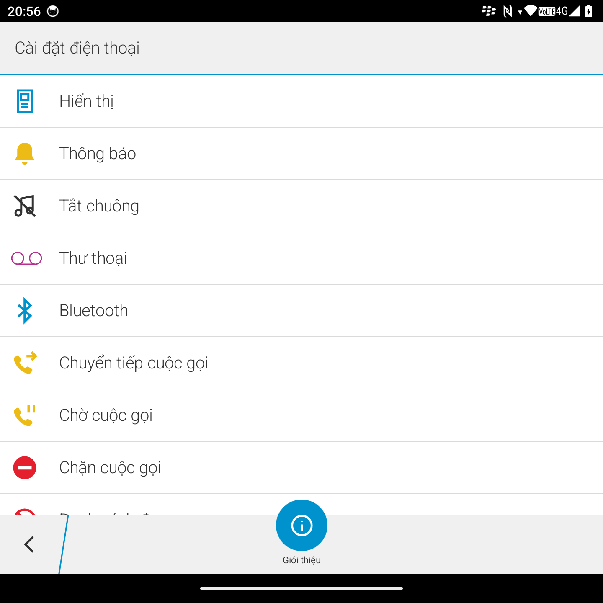
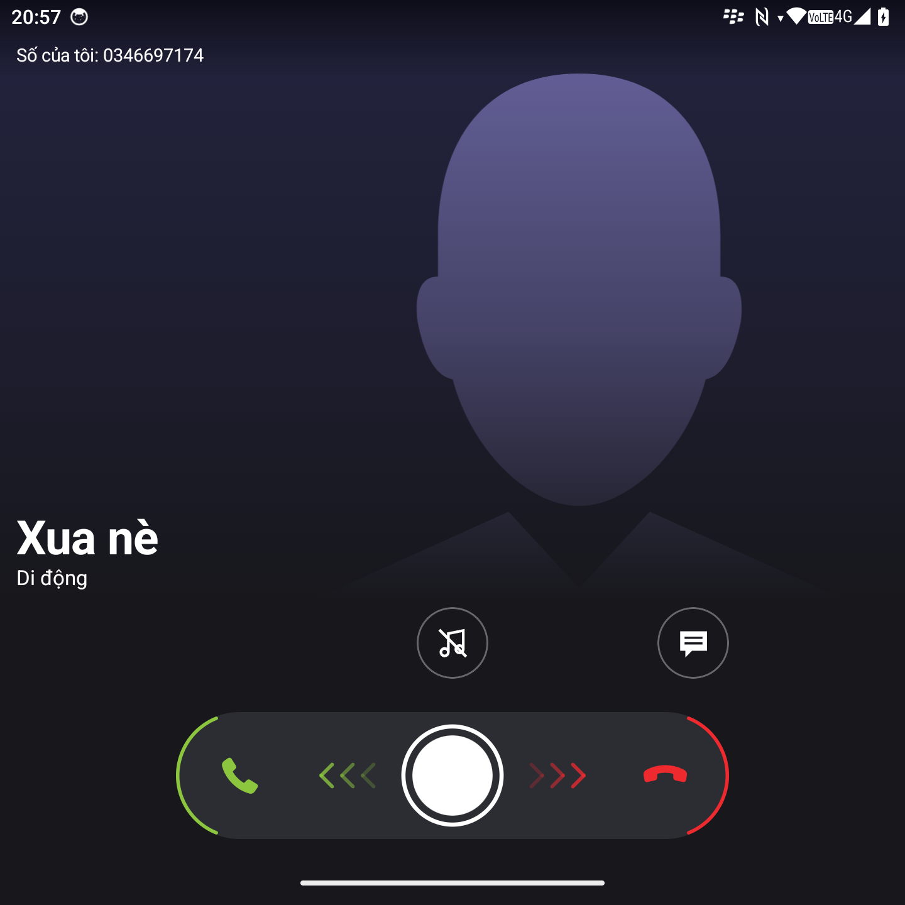
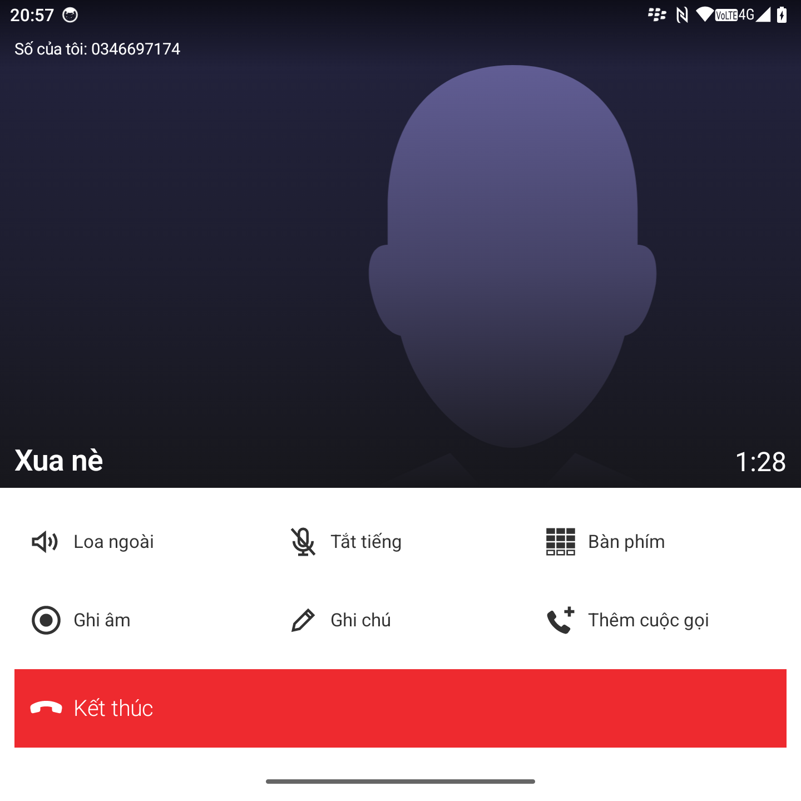

# BB10 Dialer

[Tiếng Việt](README.md) | **English** | [简体中文](README.zh-CN.md)

A phone app for Android with the look of a BlackBerry 10 phone. Written in Kotlin and Jetpack Compose, it can be your default phone app, and it is made for square-screen phones with a hardware keyboard such as the Q25 and P26.

This is a personal project, not affiliated with BlackBerry. All artwork and icons are redrawn in code.

## Screenshots

The data in these pictures is made up.

<table>
  <tr>
    <td></td>
    <td></td>
    <td></td>
  </tr>
  <tr>
    <td></td>
    <td></td>
    <td></td>
  </tr>
</table>

## Features

**Calls**
- Replaces the default phone app: place and answer calls, with a full-screen call screen, also on the lock screen.
- Drag to answer or decline, silence the ringer.
- Hold, swap and merge calls, with a list of the people in a conference.
- Notes during a call, shown under that call in the history.
- Call recording, with seeking, under that call in the history. **Requires root**, see [Call recording](#call-recording).

**Contacts and history**
- Call history by day, quick contacts, and a dial pad that suggests matches as you type.
- View, add, edit and delete contacts.
- Pull down at the top of a list to see each SIM's number and carrier.

**Hardware keyboard**
- Choose the Q25 or P26 as your device, and the letter keys type the digits printed on them.
- On the Q25, the Call key answers and calls the selected number.

**Settings**
- A blacklist of numbers or prefixes.
- Hide the answer slider, the End Call button, and the numbers of saved contacts.
- A light or dark theme, or one that follows the system, and 6 accent colors.
- English, Vietnamese and Simplified Chinese.

## Call recording

Recording **requires a phone rooted** with Magisk or KernelSU, or a ROM with [the app built in](#building-into-a-rom). Otherwise it stays off and the call screen has no Record button.

Android only lets system apps record the phone line, so the app needs a module to count as one:

1. Set BB10 Dialer as your default phone app.
2. Go to **Settings → Call Recording**, tap **Request Root Access** and allow it in your root manager.
3. Turn on **Allow Recording Calls**. To record automatically when a call connects, also turn on the switch below it.
4. Tap **Record the Phone Line** to install the module, then choose **Restart**.
5. Make a test call, record it and listen back to check that both sides are there. Not every phone passes the sound on; on a Q25 with root and the module, recording works.

**To remove:** on the same page, tap **Remove Line Recording** and restart the phone. If the phone gets stuck while starting, boot into Magisk's safe mode to turn the module off.

**Changing the signing key:** the module holds a copy of the app, so after changing the key you must remove the module, reinstall the app and install the module again.

Laws on recording calls vary by where you live. Checking and following them is your responsibility.

## Not done yet

**Outgoing calls and voicemail**
- Specific messages for no signal, airplane mode and a locked SIM.
- Holding the 1 key to call voicemail, and handling `voicemail:` requests from other apps.
- Changing the phone line from the menu (the item is disabled).

**During a call**
- HD and Wi-Fi labels.
- Video and RTT calls: currently answered with audio only.
- Multi-step USSD.
- Special handling for a cellular call arriving during a Zalo or Messenger call.

**Blocking**
- Detecting spam automatically: currently only the list you enter is blocked.

## Building into a ROM

For ROM developers who want the app in the system, recording calls without root or a module. Once the app has the phone line permission, the Call Recording page hides the root and module parts by itself.

These steps have not been tried on a real ROM. Configuration names may differ between Android versions.

**Requirements:** Android 14 (API 34) or later, and the source of the BB10 UI kit. The license is noncommercial: a ROM sold with a phone or for a fee needs a separate license.

**1. Add it to the ROM.** Build `release`, sign it with a fixed key, raise `versionCode` with each version, add it as a prebuilt and put `BB10Phone` in `PRODUCT_PACKAGES`:

```
android_app_import {
    name: "BB10Phone",
    apk: "app-release.apk",
    presigned: true,
    privileged: true,
    system_ext_specific: true,
    dex_preopt: { enabled: true },
    required: ["privapp-permissions-bb10phone"],
}

prebuilt_etc {
    name: "privapp-permissions-bb10phone",
    src: "privapp-permissions-bb10phone.xml",
    sub_dir: "permissions",
    system_ext_specific: true,
}
```

**2. Allow the phone line permission.** It takes the app being in `priv-app` and on the allowlist, not signing with the platform key. With `ro.control_privapp_permissions=enforce`, a missing file can stop the phone from booting.

```xml
<permissions>
    <privapp-permissions package="com.duc1607.bb10dialer">
        <permission name="android.permission.CAPTURE_AUDIO_OUTPUT" />
    </privapp-permissions>
</permissions>
```

**3. Make it the default phone app.** Overlay `config_defaultDialer` in the framework with `com.duc1607.bb10dialer`. Microphone, contacts and call log can be pre-granted with a `default-permissions` file.

**4. The stock dialer.** Keep it at first: Telecom falls back to it when the default phone app fails. To remove it, overlay Telecom's `ui_default_package`, `dialer_default_class` and `incall_default_class` with `MainActivity` and `.telecom.CallService`, then test emergency calls thoroughly.

**5. Audio in the hardware layer.** `audio_policy_configuration.xml` needs an input route for the `VOICE_CALL` source (Telephony Rx), and the Audio HAL must pass both sides of the call to it. Otherwise recordings can be silent despite the permission.

**6. Test before release.** Placing, answering and recording calls on a locked phone, including before the first unlock; recordings are kept in storage that only works after unlocking. Some places require a tone while recording, which the app does not have yet.

## Build

Requires JDK 21 and Android SDK 36. The app runs on Android 14 (API 34) and later.

The BB10 UI kit (`duc1607:bb10-kotlin-ui-kit`) comes from Maven local, so publish it first from its own repository:

```bash
./gradlew :bb10-kotlin-ui-kit:publishToMavenLocal
```

Then build the app:

```bash
./gradlew :app:assembleFast
```

`fast` is the optimized build, signed with the debug key so that it installs over a debug build and keeps its data. The debug build is much slower, so don't judge smoothness by it.

## Support

[](https://ko-fi.com/P5P21MYUO3)

## License

[PolyForm Noncommercial 1.0.0](LICENSE). In short, and only the full text in `LICENSE` is binding:

- No commercial use.
- You may use, modify and redistribute it for noncommercial purposes.
- When distributing, include the license and keep the `Required Notice` line that credits the author.
