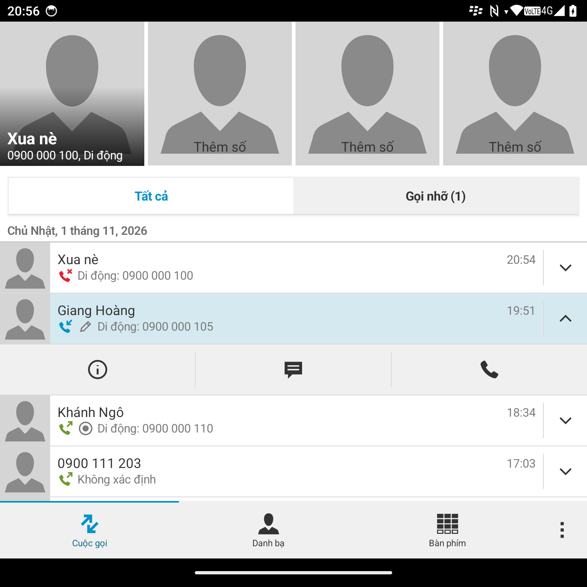
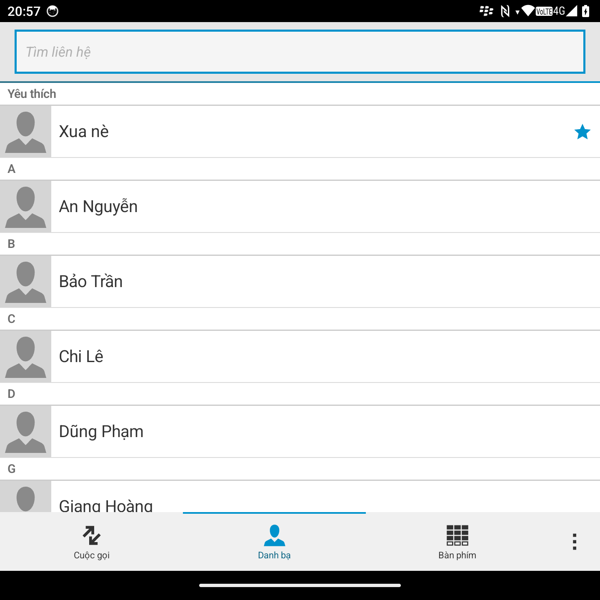
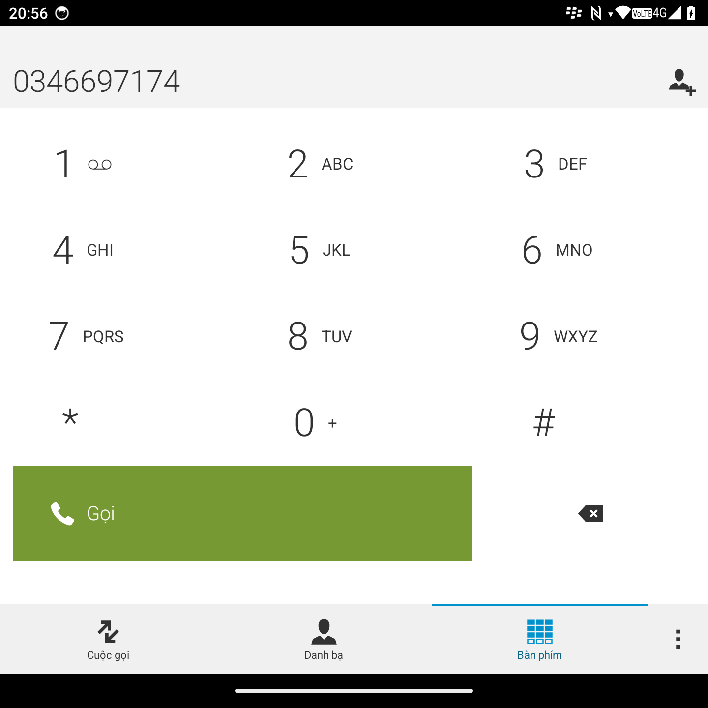
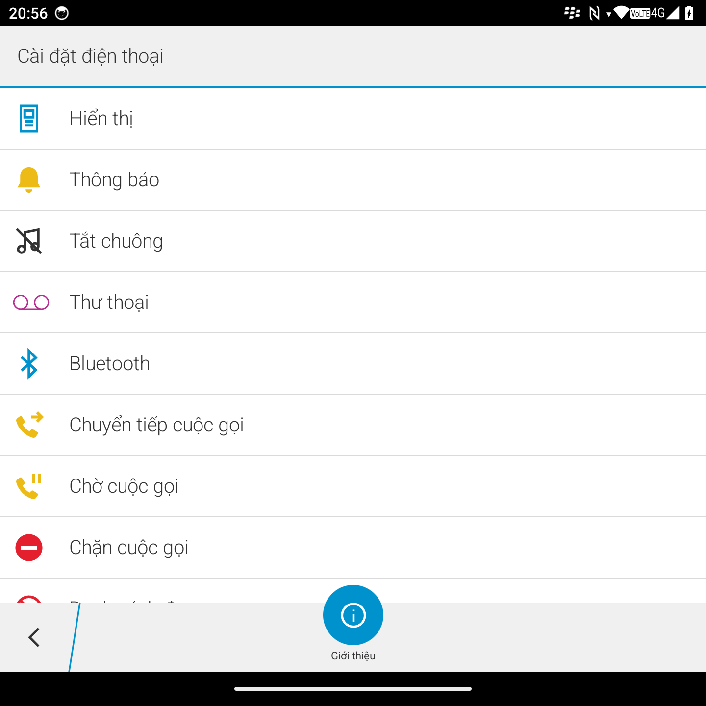
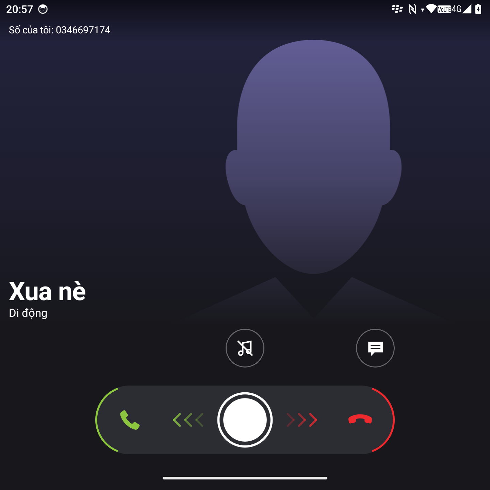
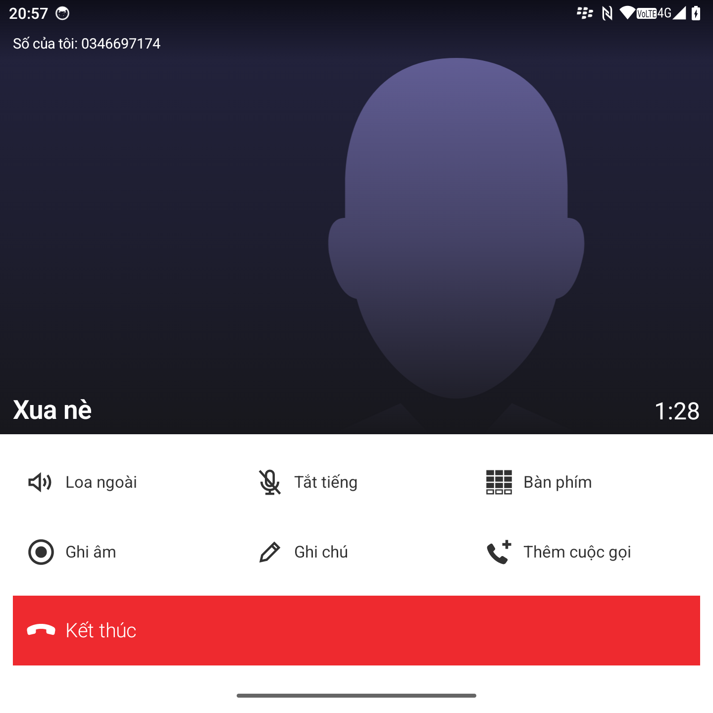

# BB10 Dialer

**Tiếng Việt** | [English](README.en.md) | [简体中文](README.zh-CN.md)

Ứng dụng gọi điện cho Android với giao diện của điện thoại BlackBerry 10. Viết bằng Kotlin và Jetpack Compose, dùng được làm ứng dụng gọi mặc định của máy, và được làm riêng cho các máy có bàn phím cứng màn vuông như Q25, P26.

Đây là dự án cá nhân, không liên quan đến BlackBerry. Mọi hình vẽ và icon đều được vẽ lại bằng code.

## Ảnh

Dữ liệu trong ảnh là dữ liệu giả.

<table>
  <tr>
    <td></td>
    <td></td>
    <td></td>
  </tr>
  <tr>
    <td></td>
    <td></td>
    <td></td>
  </tr>
</table>

## Tính năng

**Gọi điện**
- Thay thế ứng dụng gọi mặc định: gọi đi, nghe máy, màn cuộc gọi hiện toàn màn hình, kể cả trên màn khóa.
- Kéo để nghe hoặc từ chối, tắt chuông.
- Giữ máy, chuyển đổi, gộp cuộc gọi, danh sách người trong cuộc gọi hội nghị.
- Ghi chú trong cuộc gọi, xem lại ngay dưới cuộc gọi trong lịch sử.
- Ghi âm cuộc gọi, tua lại ngay dưới cuộc gọi trong lịch sử. **Cần root**, xem [Ghi âm cuộc gọi](#ghi-âm-cuộc-gọi).

**Danh bạ và lịch sử**
- Lịch sử cuộc gọi theo ngày, liên hệ nhanh, bàn phím số gợi ý theo số đang nhập.
- Xem, thêm, sửa, xóa liên hệ.
- Kéo xuống đầu danh sách để xem số và nhà mạng của từng SIM.

**Bàn phím cứng**
- Chọn thiết bị Q25 hoặc P26 để các phím chữ nhập số theo số in trên phím.
- Trên Q25, phím Gọi dùng để nghe máy và gọi số đang chọn.

**Cài đặt**
- Danh sách đen theo số hoặc đầu số.
- Ẩn thanh kéo, nút kết thúc, số điện thoại của liên hệ đã lưu.
- Giao diện sáng, tối hoặc theo hệ thống, cùng 6 màu nhấn.
- Tiếng Việt, tiếng Anh và tiếng Trung giản thể.

## Ghi âm cuộc gọi

Ghi âm **cần máy đã root** bằng Magisk hoặc KernelSU. Không có root thì tính năng này tắt và màn cuộc gọi không có nút Ghi âm.

Android chỉ cho ứng dụng hệ thống ghi đường thoại, nên ứng dụng cần một module để được coi là ứng dụng hệ thống:

1. Đặt BB10 Dialer làm ứng dụng gọi mặc định.
2. Vào **Cài đặt → Ghi âm cuộc gọi**, bấm **Yêu cầu quyền root** và đồng ý trong trình quản lý root.
3. Bật **Cho phép ghi âm cuộc gọi**. Muốn tự ghi khi cuộc gọi kết nối thì bật thêm công tắc bên dưới.
4. Bấm **Ghi đường thoại** để cài module, rồi chọn **Khởi động lại**.
5. Gọi thử một cuộc, ghi âm rồi nghe lại xem có cả hai đầu không. Không phải máy nào cũng đưa âm thanh ra đường thoại.

**Gỡ:** vào cùng trang, bấm **Gỡ ghi đường thoại** rồi khởi động lại máy. Nếu máy kẹt lúc khởi động, hãy khởi động ở safe mode của Magisk để tắt module.

**Đổi khóa ký:** module giữ một bản sao ứng dụng, nên khi đổi khóa ký phải gỡ module, cài lại ứng dụng rồi cài lại module.

Luật về ghi âm cuộc gọi khác nhau theo nơi bạn sống. Bạn tự chịu trách nhiệm kiểm tra và tuân thủ.

## Chưa làm

**Gọi đi và thư thoại**
- Thông báo riêng khi không có sóng, đang ở chế độ máy bay, SIM bị khóa.
- Giữ phím 1 để gọi thư thoại, nhận lời gọi `voicemail:` từ ứng dụng khác.
- Đổi đường dây từ menu (mục này đang tắt).

**Trong cuộc gọi**
- Nhãn HD, Wi-Fi.
- Cuộc gọi video và RTT: hiện chỉ nghe bằng âm thanh.
- USSD nhiều bước.
- Xử lý riêng khi đang gọi qua Zalo, Messenger mà có cuộc gọi di động đến.

**Chặn số**
- Tự nhận diện cuộc gọi rác: hiện chỉ chặn theo danh sách do người dùng nhập.

## Build

Cần JDK 21 và Android SDK 36. Ứng dụng chạy từ Android 14 (API 34).

Bộ giao diện BB10 (`duc1607:bb10-kotlin-ui-kit`) được lấy từ Maven local, nên cần publish trước trong repo của nó:

```bash
./gradlew :bb10-kotlin-ui-kit:publishToMavenLocal
```

Sau đó build ứng dụng:

```bash
./gradlew :app:assembleFast
```

`fast` là bản đã tối ưu, ký bằng khóa debug nên cài đè được lên bản debug mà giữ dữ liệu. Bản debug chạy chậm hơn nhiều, nên đừng dùng nó để đánh giá độ mượt.

## Ủng hộ

[](https://ko-fi.com/P5P21MYUO3)

## Giấy phép

[PolyForm Noncommercial 1.0.0](LICENSE). Tóm tắt, bản đầy đủ trong file `LICENSE` mới có giá trị:

- Không được dùng vào mục đích thương mại.
- Được sử dụng, chỉnh sửa và phân phối lại cho mục đích phi thương mại.
- Khi phân phối, phải kèm giấy phép và giữ dòng `Required Notice` ghi công tác giả.
