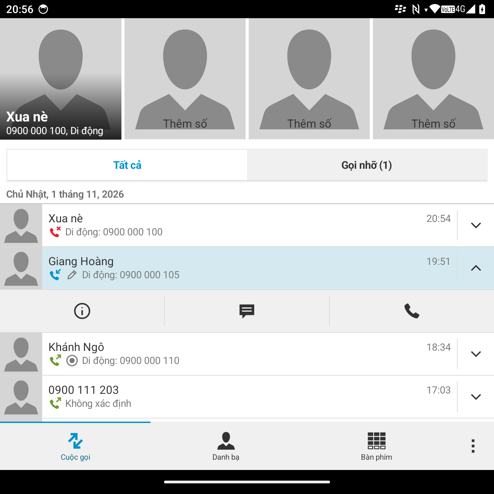
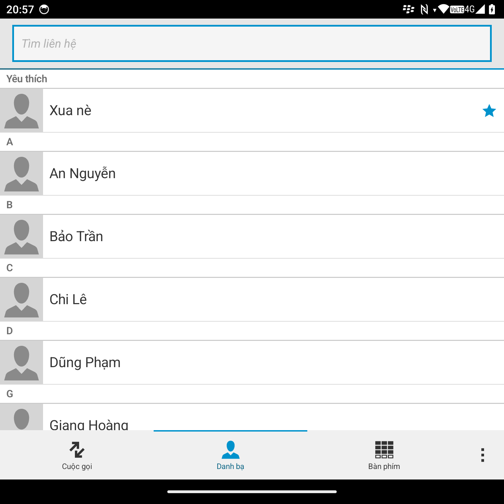
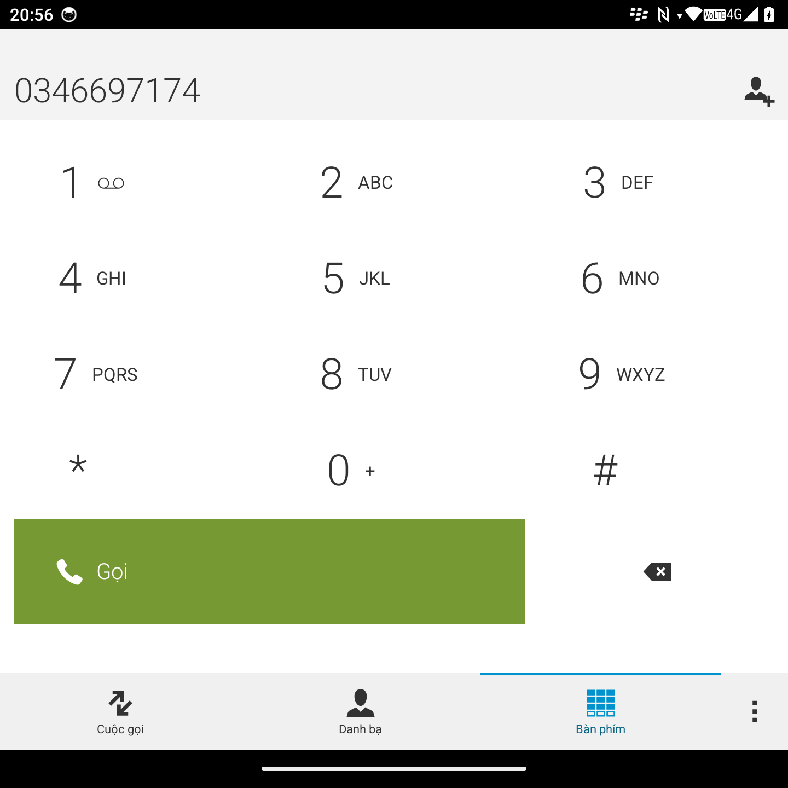
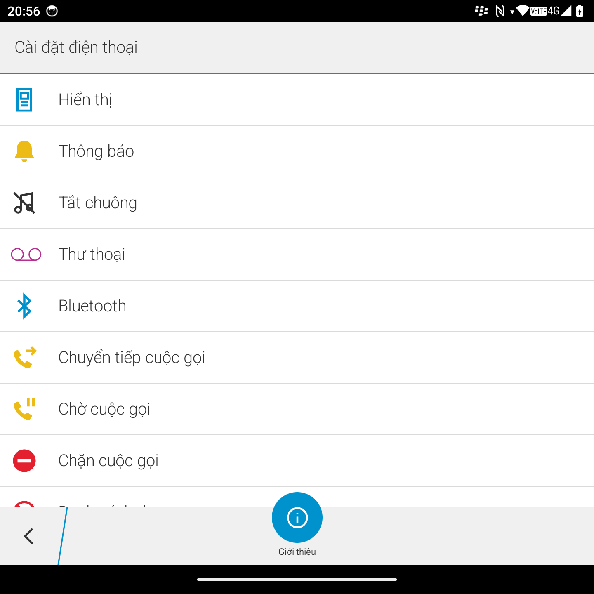
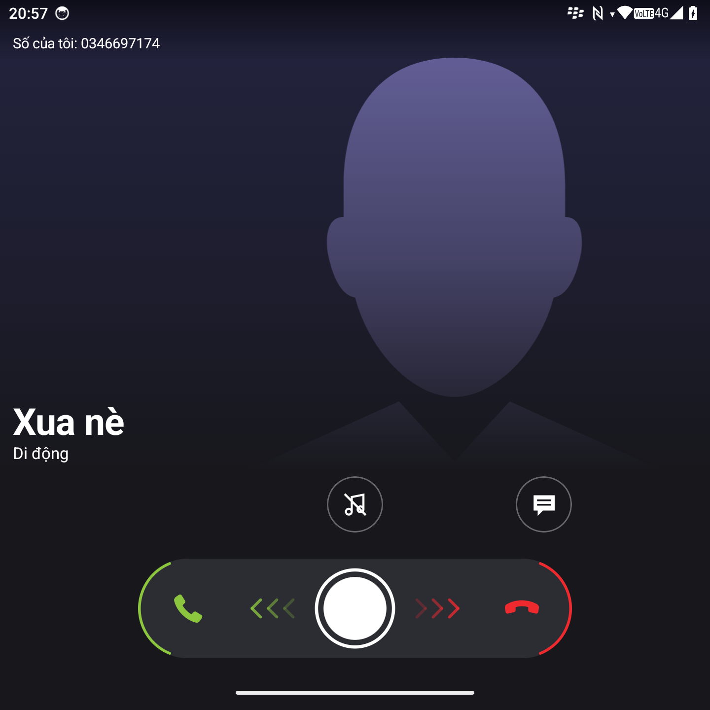
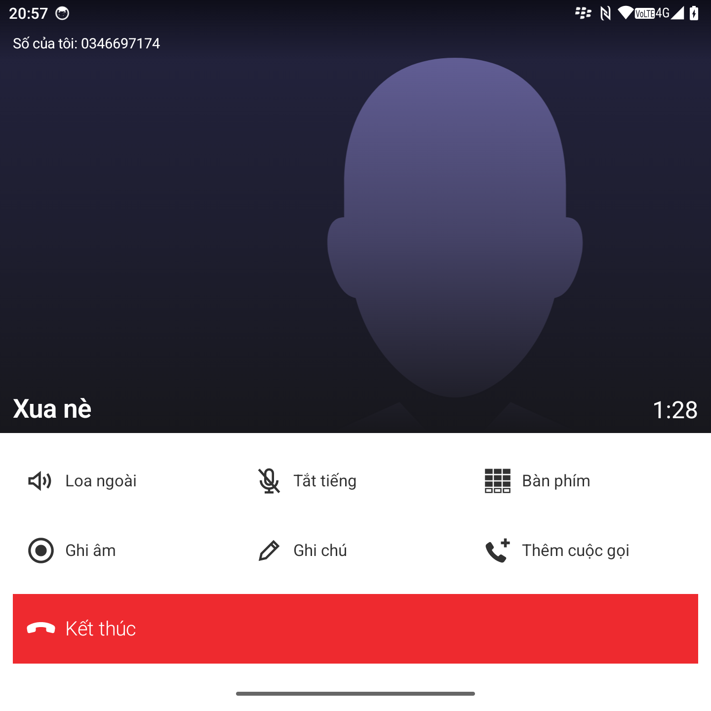

# BB10 Dialer

[Tiếng Việt](README.md) | [English](README.en.md) | **简体中文**

一款具有 BlackBerry 10 手机外观的 Android 电话应用。使用 Kotlin 和 Jetpack Compose 编写，可设为默认电话应用，专为 Q25、P26 等方屏全键盘手机打造。

这是个人项目，与 BlackBerry 无关。所有图形和图标均由代码重新绘制。

## 截图

截图中的数据均为虚构。

<table>
  <tr>
    <td></td>
    <td></td>
    <td></td>
  </tr>
  <tr>
    <td></td>
    <td></td>
    <td></td>
  </tr>
</table>

## 功能

**通话**
- 替代默认电话应用：拨打和接听电话，通话界面全屏显示，锁屏时也一样。
- 拖动接听或拒接，静音铃声。
- 保持、切换和合并通话，查看多方通话成员。
- 通话时写备注，并显示在通话记录中对应的通话下方。
- 通话录音，可在通话记录中对应的通话下方拖动回听。**需要 Root**，详见[通话录音](#通话录音)。

**联系人和通话记录**
- 按日期显示通话记录、快捷联系人，拨号盘会根据输入提示匹配的号码。
- 查看、添加、编辑和删除联系人。
- 在列表顶部下拉可查看每张 SIM 卡的号码和运营商。

**实体键盘**
- 选择设备为 Q25 或 P26 后，字母键可输入键上印的数字。
- 在 Q25 上，通话键可接听来电并呼叫所选号码。

**设置**
- 按号码或号段设置黑名单。
- 隐藏接听滑块、结束通话按钮和已保存联系人的号码。
- 浅色或深色外观，也可跟随系统，并有 6 种强调色。
- 支持英语、越南语和简体中文。

## 通话录音

录音**需要手机已通过 Magisk 或 KernelSU 获取 Root**，或使用[内置本应用的 ROM](#集成到-rom)。否则此功能保持关闭，通话界面也不显示录音按钮。

Android 只允许系统应用录制通话线路，因此应用需要通过一个模块被视为系统应用：

1. 将 BB10 Dialer 设为默认电话应用。
2. 进入**设置 → 通话录音**，轻触**请求 Root 权限**，并在 Root 管理器中允许。
3. 开启**允许通话录音**。如需在通话接通时自动录音，再开启下方的开关。
4. 轻触**录制通话线路**安装模块，然后选择**重启**。
5. 拨打一通测试电话并录音，回听确认双方声音都有。并非所有手机都会输出声音；在已 Root 并安装模块的 Q25 上录音正常。

**移除：**在同一页面轻触**移除线路录音**，然后重启手机。如果手机卡在启动过程中，请进入 Magisk 安全模式以关闭模块。

**更换签名密钥：**模块保存了一份应用副本，因此更换密钥后必须先移除模块，重新安装应用，再重新安装模块。

各地关于通话录音的法律不同。请自行了解并遵守。

## 尚未完成

**去电和语音信箱**
- 针对无信号、飞行模式和 SIM 卡锁定的专门提示。
- 长按 1 键呼叫语音信箱，以及处理其他应用的 `voicemail:` 请求。
- 从菜单切换电话线路（该菜单项目前已停用）。

**通话中**
- HD、Wi-Fi 标签。
- 视频通话和 RTT：目前仅以音频接听。
- 多步 USSD。
- 在 Zalo、Messenger 通话期间收到蜂窝来电时的专门处理。

**拦截**
- 自动识别骚扰电话：目前只拦截您输入的名单。

## 集成到 ROM

面向希望将应用内置到系统的 ROM 开发者，无需 Root 或模块即可通话录音。应用获得通话线路权限后，通话录音页面会自动隐藏 Root 和模块相关内容。

这些步骤尚未在真实 ROM 上试过。配置名称可能因 Android 版本而异。

**要求：**Android 14（API 34）及以上，并需要 BB10 界面套件的源码。本应用采用非商业许可证：随手机销售或收费的 ROM 需要另行取得许可。

**1. 加入 ROM。**构建 `release`，使用固定密钥签名，每个版本提高 `versionCode`，以 prebuilt 方式添加，并将 `BB10Phone` 加入 `PRODUCT_PACKAGES`：

```
android_app_import {
    name: "BB10Phone",
    apk: "app-release.apk",
    presigned: true,
    privileged: true,
    system_ext_specific: true,
    dex_preopt: { enabled: true },
    required: ["privapp-permissions-bb10phone"],
}

prebuilt_etc {
    name: "privapp-permissions-bb10phone",
    src: "privapp-permissions-bb10phone.xml",
    sub_dir: "permissions",
    system_ext_specific: true,
}
```

**2. 允许通话线路权限。**应用需位于 `priv-app` 并列入允许名单，无需使用平台密钥签名。如果设备启用了 `ro.control_privapp_permissions=enforce` 而缺少此文件，手机可能无法启动。

```xml
<permissions>
    <privapp-permissions package="com.duc1607.bb10dialer">
        <permission name="android.permission.CAPTURE_AUDIO_OUTPUT" />
    </privapp-permissions>
</permissions>
```

**3. 设为默认电话应用。**在 framework 中 overlay `config_defaultDialer` 为 `com.duc1607.bb10dialer`。麦克风、联系人和通话记录权限可通过 `default-permissions` 文件预先授予。

**4. 原有拨号应用。**建议先保留：默认电话应用出错时，Telecom 会回退到它。如要移除，请 overlay Telecom 的 `ui_default_package`、`dialer_default_class` 和 `incall_default_class`，指向 `MainActivity` 和 `.telecom.CallService`，然后充分测试紧急呼叫。

**5. 硬件层音频。**`audio_policy_configuration.xml` 需要为 `VOICE_CALL` 音源（Telephony Rx）提供输入路由，Audio HAL 也必须将通话双方的声音输出到该路由。否则即使有权限，录音也可能没有声音。

**6. 发布前测试。**在手机锁定时拨打、接听和录音，包括首次解锁之前；录音保存在解锁后才可用的存储中。某些地区要求录音时播放提示音，应用目前还没有此功能。

## 构建

需要 JDK 21 和 Android SDK 36。应用可在 Android 14（API 34）及以上版本运行。

BB10 界面套件（`duc1607:bb10-kotlin-ui-kit`）来自 Maven local，因此需要先在其仓库中发布：

```bash
./gradlew :bb10-kotlin-ui-kit:publishToMavenLocal
```

然后构建应用：

```bash
./gradlew :app:assembleFast
```

`fast` 是经过优化的版本，使用调试密钥签名，因此可以覆盖安装调试版并保留数据。调试版要慢得多，请不要以它来判断流畅度。

## 支持

[](https://ko-fi.com/P5P21MYUO3)

## 许可证

[PolyForm Noncommercial 1.0.0](LICENSE)。以下仅为摘要，以 `LICENSE` 文件的完整文本为准：

- 不得用于商业用途。
- 可出于非商业目的使用、修改和再分发。
- 分发时必须附带许可证，并保留署名作者的 `Required Notice` 行。
